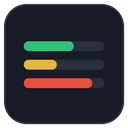

# AI Usage

Lightweight Windows 11 Tauri v2 desktop widget displaying live subscription usage windows for **Claude, Codex, Antigravity, Ollama Cloud, and Cursor**.

<br clear="left" />

> [!WARNING]
> **Alpha Version — Do Not Use.** This project is an early personal alpha under active development and is **not ready for general use**. Expect breaking changes, unfinished behavior, and unannounced upstream provider API changes.

## Features

- **Always-on-top float bar** — draggable, resizable, configurable opacity, optional click-through mode, and green/amber/red threshold bars.
- **Click-to-expand detail view** — click the float bar (or open the popup from the system tray) to view pace markers, reset countdowns, `$` quota amounts, and per-model lanes.
- **Honest states** — reports `auth-required`, `not-running`, `no-data`, or `parse-failed` rather than fabricating `0%`.
- **Hot-reloaded config** — settings live in `%APPDATA%\ai-usage\config.json` and update live without restarting; includes autostart and signed **auto-updates** via GitHub Releases (toggleable in Settings).

## Supported Providers

| Provider | Shown Windows | Credential / Data Source |
|---|---|---|
| **Claude** | `5h`, weekly, extra usage | Reads `~/.claude/.credentials.json` (Claude Code login) |
| **Codex** | `5h`, weekly, model-specific limits | Reads `~/.codex/auth.json` (Codex CLI login) |
| **Antigravity** | Weekly, `5h`, per-model groups (Gemini / Others / Argon) | Probes local IDE language server or bundled `agy` CLI (optional read-only IDE Google OAuth fallback when closed) |
| **Ollama Cloud** | Monthly allowance (or legacy session/weekly) | Uses `OLLAMA_API_KEY` (Settings, env var, or `.env`) |
| **Cursor** | Pro plan `auto`, `api`, `on-demand` lanes | Reads Cursor IDE local session (`state.vscdb`, DPAPI + AES-GCM) |

## Privacy & Credentials

- Zero telemetry or third-party backend servers; all requests go directly from your machine to each provider's usage endpoint.
- Existing CLI and IDE credential files/databases are opened **read-only** and are never modified on disk. Claude and Codex access tokens are read on every poll; expired logins must be refreshed through the owning CLI.
- Ollama keys entered in Settings are stored **unencrypted** in `%APPDATA%\ai-usage\config.json` (and may appear in config backups). To avoid saving a key in this file, leave the Settings field blank and supply `OLLAMA_API_KEY` in the app's environment. `.env` files also store keys as plaintext; keep them private and out of version control.
- Provider usage endpoints are unofficial/internal and may change without notice.

## Install (Windows 11 x64)

Current builds are **alpha pre-releases (do not use in production)**. Download `AI.Usage_<version>_x64-setup.exe` (NSIS installer), `.msi`, or portable `ai-usage.exe` from [Releases](https://github.com/sebaram/ai-subscription-widget/releases).

> Builds are currently Windows-unsigned (Authenticode), so Windows SmartScreen may show *"Windows protected your PC"* on the initial download — click **More info → Run anyway**. Subsequent signed auto-updates install passively in the background without browser SmartScreen prompts.

## Development

### Prerequisites

- Node.js 20.19+ or 22.12+ (Node 22 LTS recommended)
- Rust stable (`x86_64-pc-windows-msvc`) + Visual Studio Build Tools (C++ workload)
- Microsoft Edge WebView2 (preinstalled on Windows 11)

### Commands

```bash
npm install
npm run tauri dev
```

Run checks and production build:

```bash
npm test
npm run build
cargo test --manifest-path src-tauri/Cargo.toml
npx tauri build --no-sign
```

To cut a signed release with automatic update metadata (`latest.json`), bump the version in `package.json`, `src-tauri/Cargo.toml`, and `src-tauri/tauri.conf.json`, then push a tag:

```bash
git tag vX.Y.Z && git push origin main --tags
```

## Acknowledgments & License

Provider API research was informed by [steipete/CodexBar](https://github.com/steipete/CodexBar) and [nesszer/Win-CodexBar](https://github.com/nesszer/Win-CodexBar).

Licensed under the [MIT License](LICENSE).
